<!--
  CSIA — org profile README
  Location in repo: .github/profile/README.md  (repo name: ".github")
  All visuals live in ./assets as hand-written SVG (CSS/SMIL animation, no JavaScript).
-->










 

<kbd>plain-text transmission</kbd>

 

**CSIA — Cyber Security & Artificial Intelligence**

**LEARN IT → DO IT → PITCH IT.** There are no limits to what we can do.

| Cell | Mission |
| :-- | :-- |
| Projects | Turning ambitious ideas into real-world projects. |
| Data & AI Science | AI workshops, technical formations, conferences and events. |
| Cyber & CTF | Cybersecurity workshops, hands-on training, CTFs and conferences. |
| Communication & Sponsoring | Building connections, partnerships and opportunities. |
| Media & Documentation | Capturing our journey, sharing knowledge and documenting innovation. |
| Organisation | Making ideas happen through coordination and execution. |

**SHIELD UP. MINDS ON. TOGETHER WE RISE.**

